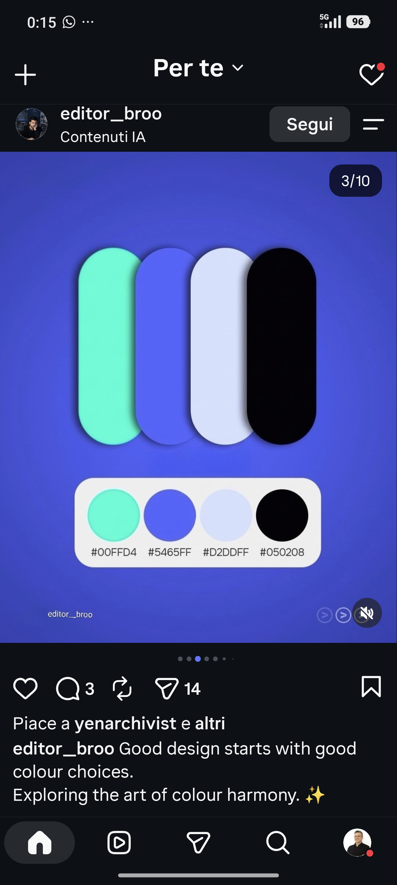
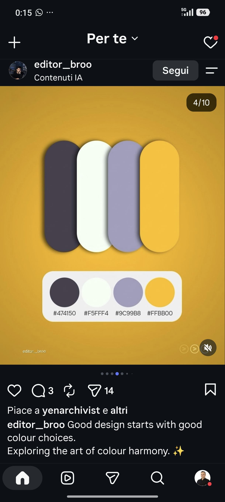
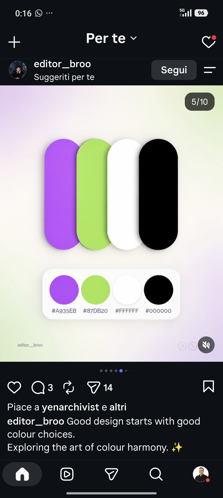
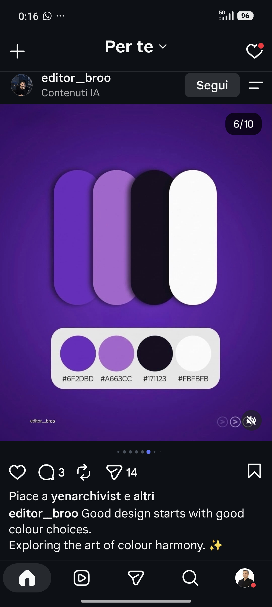
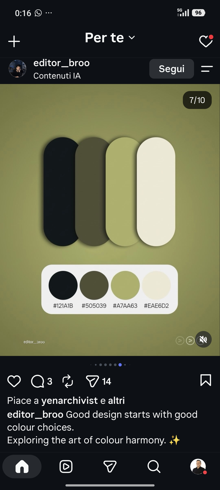
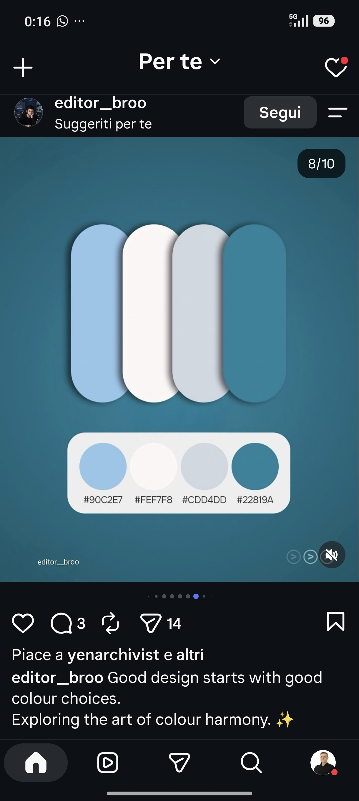
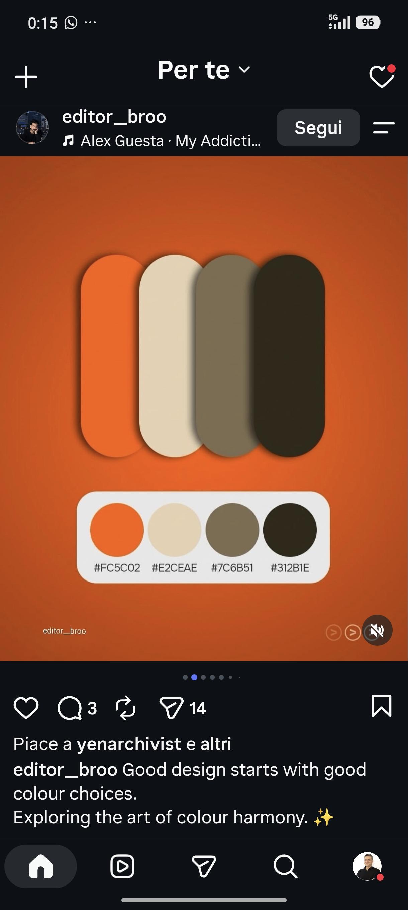

# Colori — libreria di palette e font

Palette di colori (4 tonalità ciascuna) raccolte da esempi di riferimento, pronte da riutilizzare nei progetti.

- `palettes.json` — dati strutturati (hex, ruolo, mood, font suggeriti) — **fonte unica**
- `palettes.css` — variabili CSS pronte (`var(--oliva-1)`, `var(--oliva-scuro)`, `var(--oliva-font-titoli)` …)
- `index.html` — anteprima visiva di palette + font (clic su un colore = copia hex)
- `riferimenti/` — immagini originali
- `genera.py` — rigenera CSS, README e anteprima dopo aver modificato il JSON

> I font sono **abbinamenti suggeriti** (Google Fonts): le immagini di riferimento contengono solo i colori.

## Palette

### Arancio Terra
*caldo, naturale, energico, outdoor*

| # | Hex | Ruolo |
|---|---|---|
| 1 | `#FC5C02` | accento |
| 2 | `#E2CEAE` | chiaro |
| 3 | `#7C6B51` | neutro |
| 4 | `#312B1E` | scuro |

Sfondo: `#FC5C02` · Font: **Archivo Black** (titoli) + **Inter** (testo)

### Acqua Indaco
*tech, digitale, fresco, startup*

| # | Hex | Ruolo |
|---|---|---|
| 1 | `#00FFD4` | accento |
| 2 | `#5465FF` | primario |
| 3 | `#D2DDFF` | chiaro |
| 4 | `#050208` | scuro |

Sfondo: `#5465FF` · Font: **Space Grotesk** (titoli) + **Inter** (testo)

### Giallo Lavanda
*solare, amichevole, moderno, creativo*

| # | Hex | Ruolo |
|---|---|---|
| 1 | `#474150` | scuro |
| 2 | `#F5FFF4` | chiaro |
| 3 | `#9C99B8` | neutro |
| 4 | `#FFBB00` | accento |

Sfondo: `#FFBB00` · Font: **Poppins** (titoli) + **DM Sans** (testo)

### Viola Lime
*audace, giovane, pop, contrasto alto*

| # | Hex | Ruolo |
|---|---|---|
| 1 | `#A935EB` | primario |
| 2 | `#87DB20` | accento |
| 3 | `#FFFFFF` | chiaro |
| 4 | `#000000` | scuro |

Sfondo: `#87DB20` · Font: **Syne** (titoli) + **Manrope** (testo)

_Presente in due varianti: sfondo chiaro sfumato viola/lime e sfondo lime pieno (riferimenti/04b-viola-lime-sfondo-lime.jpg)._

### Viola Notte
*elegante, notturno, premium, musica*

| # | Hex | Ruolo |
|---|---|---|
| 1 | `#6F2DBD` | primario |
| 2 | `#A663CC` | secondario |
| 3 | `#171123` | scuro |
| 4 | `#FBFBFB` | chiaro |

Sfondo: `#6F2DBD` · Font: **Unbounded** (titoli) + **Outfit** (testo)

### Oliva
*organico, sobrio, sostenibile, editoriale*

| # | Hex | Ruolo |
|---|---|---|
| 1 | `#121A1B` | scuro |
| 2 | `#505039` | neutro |
| 3 | `#A7AA63` | primario |
| 4 | `#EAE6D2` | chiaro |

Sfondo: `#A7AA63` · Font: **Playfair Display** (titoli) + **Lora** (testo)

### Cielo
*calmo, pulito, affidabile, salute*

| # | Hex | Ruolo |
|---|---|---|
| 1 | `#90C2E7` | primario |
| 2 | `#FEF7F8` | chiaro |
| 3 | `#CDD4DD` | neutro |
| 4 | `#22819A` | scuro |

Sfondo: `#22819A` · Font: **Nunito** (titoli) + **Nunito Sans** (testo)

## Aggiungere nuove palette

1. Aggiungi un oggetto all'array `palette` in `palettes.json` (stessa struttura).
2. Salva l'immagine in `riferimenti/`.
3. Esegui `python3 genera.py`.
